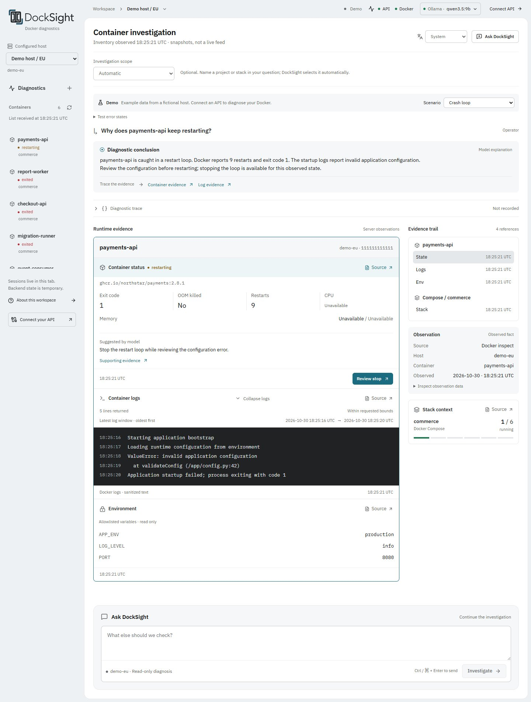
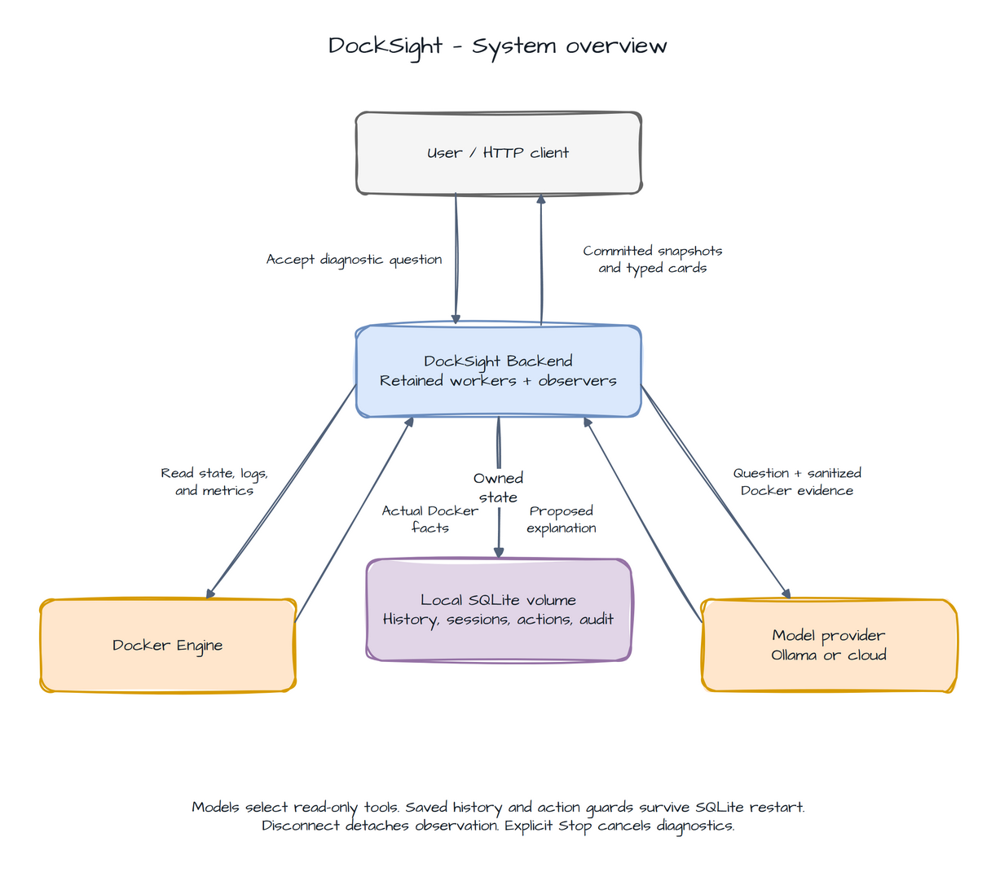

# DockSight


**Docker troubleshooting with AI explanations and runtime evidence.**

Find out why a container keeps restarting, ran out of memory, or failed to start. DockSight brings Docker state,
logs, and model explanations into one workspace, with restart and stop actions you review and confirm.



*Demo workspace with simulated observations. No Docker connection or model is required to try it.*

- **Follow the evidence.** Inspect container state, logs, metrics, allowlisted environment values, and Compose context.
- **Ask follow-up questions.** Investigate a problem in a session scoped to one Docker host.
- **Choose your model.** Use Ollama locally, OpenAI, Anthropic, Gemini, or a compatible API.
- **Review before acting.** Models have read-only tools; restart and stop require separate confirmation.
- **Work in English or Russian.** Switch the interface language without losing the active investigation.

## Quick start

Clone the repository and run the commands below from its root:

```sh
git clone https://github.com/Neizvestnyj/DockSight.git
cd DockSight
```

### Try the demo

Requires [Node.js 24 LTS](https://nodejs.org/).

```sh
npm --prefix frontend ci
npm --prefix frontend run dev
```

Open the printed URL, normally [localhost:5173](http://localhost:5173). Choose a scenario such as **Crash loop** or
**Out of memory**, inspect its evidence, and review a simulated action. Demo never changes Docker resources.

### Connect your Docker environment

Also requires [Python 3.12+](https://www.python.org/), [uv](https://docs.astral.sh/uv/),
[Docker Engine or Desktop](https://docs.docker.com/get-started/get-docker/), and [Ollama](https://ollama.com/).
Development uses Python 3.14. Start Docker and Ollama before continuing.

**1. Prepare the backend.** The commands below use PowerShell; on Linux/macOS, replace `Copy-Item` with `cp`.

```powershell
uv sync --project backend --locked
Copy-Item .env.example .env
uv run --project backend python -c "import secrets; print(secrets.token_urlsafe(32))"
ollama pull qwen3.5:9b
```

Set `DOCKSIGHT_API_TOKEN` in `.env` to the generated token. Keep the other defaults for local Ollama, or choose
[another provider](docs/configuration.md#model-providers).

**2. Start the backend in one terminal.**

```sh
uv run --project backend uvicorn docksight.main:create_app --factory --host 127.0.0.1 --port 8000 --workers 1
```

**3. Keep the frontend running in another terminal** using the demo commands above. Choose **Connect API**, keep
`/api/v1`, and enter the same token. Select a host and container, then ask what went wrong. The token stays in browser
memory. Interactive API documentation is available at [localhost:8000/docs](http://localhost:8000/docs).

For a reproducible failure and confirmed restart, follow the [working example](docs/examples.md#docker-example).

## How it works

The backend collects Docker observations, asks the model to explain them, validates its evidence references, and returns
typed UI cards. Runtime values and permissions come from the backend. Confirmed actions use a separate execution path.



Sessions and action records are temporary. Use one backend worker; restarting it clears that state. DockSight provides
diagnosis and confirmed container actions; it has no persistent monitoring history or stack deployment workflow.

## Configuration

Settings are loaded from environment variables or the root `.env` file.

| Variable | Purpose |
|----------|---------|
| `DOCKSIGHT_API_TOKEN` | Required bearer token, at least 24 characters |
| `DOCKSIGHT_PROVIDER` | `ollama` (default), `openai`, `anthropic`, `gemini`, or `compatible` |
| `DOCKSIGHT_MODEL` | Model name; defaults to `qwen3.5:9b` |
| `DOCKSIGHT_MODEL_BASE_URL` | Custom model endpoint |
| `DOCKSIGHT_MODEL_API_KEY` | Credentials for the selected provider |
| `DOCKSIGHT_HOSTS_FILE` | YAML configuration for local, SSH, or mTLS Docker hosts |

See [configuration and deployment](docs/configuration.md) for provider examples, CORS, limits, and Docker connections.

## Documentation

- [Documentation index](docs/README.md) — guides and technical references.
- [Usage examples](docs/examples.md) — browser investigation and a reproducible Docker failure.
- [HTTP API](docs/api.md) — authentication, reads, diagnostic streams, and confirmed actions.
- [Architecture](docs/architecture.md) — backend boundaries and diagrams.
- [Contributing](CONTRIBUTING.md) — development setup, checks, and contribution guidelines.
- [Changelog](CHANGELOG.md) — release changes.

For development shortcuts, optional [Make commands](CONTRIBUTING.md#make-commands) provide setup, server,
check, test, and build targets. Run `make help` to list them.
