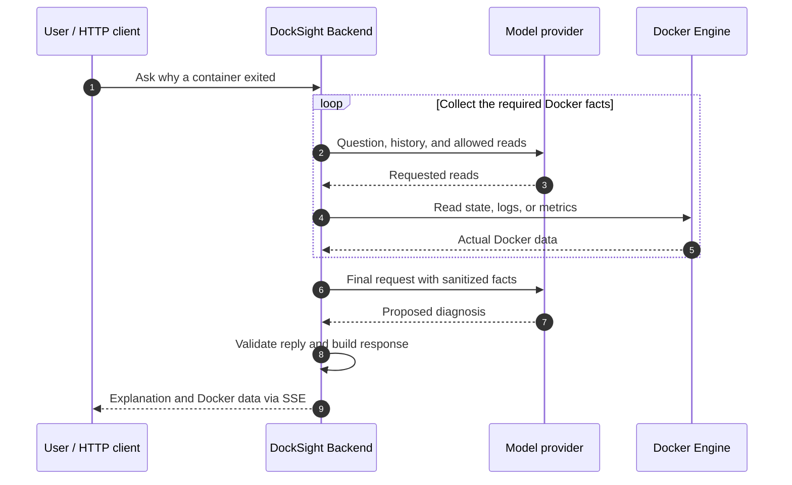
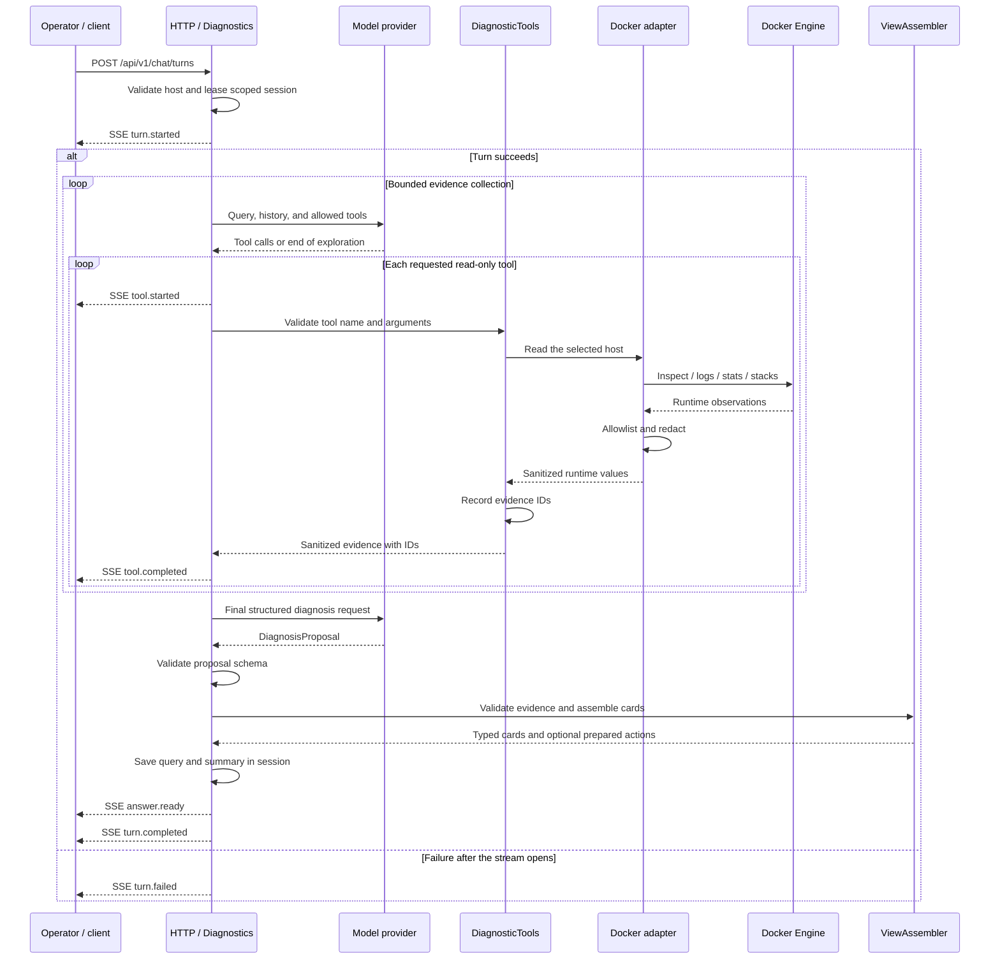
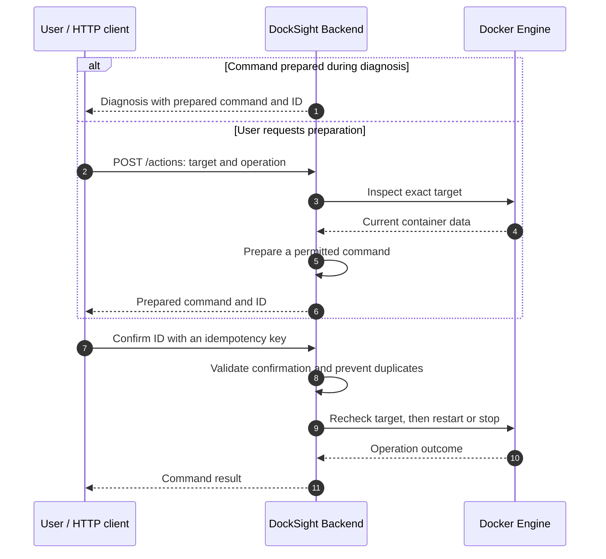
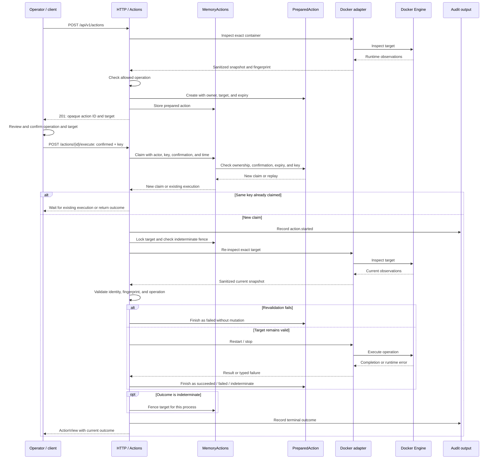

# HTTP API

Base path: `/api/v1`. All API routes require `Authorization: Bearer TOKEN`. `/health/live`, `/health/ready`, `/docs`,
and `/openapi.json` are public.

| Method | Path                                           | Result                                               |
|--------|------------------------------------------------|------------------------------------------------------|
| GET    | `/hosts`                                       | Configured host IDs and display names                |
| GET    | `/hosts/{host}/containers`                     | Up to 200 inspected containers                       |
| GET    | `/hosts/{host}/containers/{id}`                | Sanitized snapshot                                   |
| GET    | `/hosts/{host}/containers/{id}/logs?lines=200` | Bounded timestamped logs                             |
| GET    | `/hosts/{host}/containers/{id}/stats`          | CPU/memory observations; unavailable values are null |
| GET    | `/hosts/{host}/stacks?kind=compose`            | Compose groups; `swarm` requires a manager           |
| GET    | `/widgets/schema`                              | Versioned JSON Schema for response cards             |
| POST   | `/chat/turns`                                  | Diagnostic SSE stream                                |
| POST   | `/actions`                                     | Prepare an action without executing it               |
| GET    | `/actions/{id}`                                | Current action outcome                               |
| POST   | `/actions/{id}/execute`                        | Explicitly confirmed execution                       |

Errors contain `code`, `message`, and a request ID where available. Validation errors omit submitted values. Request
bodies are limited to 16 KiB. Host IDs resolve through server configuration; callers cannot submit connection URLs. At
the byte limit, logs omit the incomplete trailing line before redaction.

Container and stack GET requests follow this read path. The Docker adapter applies field allowlists and redaction
before returning owned values; the HTTP adapter serializes them as JSON.

```text
Client -> HTTP adapter -> RuntimeQueries -> Docker adapter -> Docker Engine
Client <- JSON response <- owned runtime values <- sanitized observations
```

`GET /hosts` reads configured host metadata without contacting Docker. Diagnostic requests use the model loop below.

## Diagnostic stream

POST a JSON body containing `host`, `query` (1-4000 characters), and optionally `session_id`. Sessions are bound to the
authenticated operator and selected host. Use streaming `fetch`, an HTTP client, or `curl -N`; browser EventSource
cannot POST this request or attach its bearer header.

For a query such as "Why did this container exit?", the successful path is:



In the overview, Backend includes HTTP handling, use cases, and outbound adapters. The detailed sequences expand these
parts and keep Docker Engine separate from the Docker adapter. Evidence means collected, sanitized Docker data with
server-issued reference IDs; a proposal is the model's suggested response.

<details>
<summary>Implementation details: tools, validation, and SSE events</summary>



Each requested tool emits its own progress events. Model and tool budgets bound exploration; finalization allows one
schema or evidence repair attempt. Container status cards prepare allowed actions through an internal `Actions.prepare`
call. Executing those actions requires the separate confirmation flow below.

</details>

Events carry `schema_version: 1`, `request_id`, and `turn_id`:

1. `turn.started` includes the session ID.
2. `tool.started` and `tool.completed` report progress without exposing arguments.
3. `answer.ready` includes the validated summary, evidence, and typed widgets.
4. Exactly one terminal event is `turn.completed` or `turn.failed`.

SSE comments provide heartbeats. Failures after streaming starts remain HTTP 200 and are represented by `turn.failed`.
Disconnecting cancels diagnostic work. Streams do not support replay or automatic reconnection.

## Actions

Prepare with `host`, an exact 64-character `container_id`, and `operation` (`restart` or `stop`). Cards can already
contain server-prepared action IDs: card assembly calls `Actions.prepare` internally, using the same preparation
workflow without an HTTP request.

The action ID must already be prepared before confirmation. There are two sources for it:



The idempotency key identifies one execution attempt so a repeated request can reuse its result. A command whose target
changed is rejected before mutation. The [action lifecycle](architecture.md#prepared-action-lifecycle) explains the
possible outcomes, including an unknown Docker result.

<details>
<summary>Implementation details: preparation, duplicate requests, and execution</summary>

This sequence follows direct API preparation. During diagnosis, `ViewAssembler` calls the same `Actions.prepare`
workflow. A claim reserves one execution; a fingerprint records the observed container identity and state; a target
fence blocks further commands after an unknown result.



Invalid claims are rejected before execution. An unavailable initial audit output prevents mutation. Revalidation
failures end as `failed`; a started mutation with an unknown result ends as `indeterminate`.

</details>

Review the operation and target, then execute with:

```http
POST /api/v1/actions/ACTION_ID/execute
Authorization: Bearer TOKEN
Idempotency-Key: review-restart-1
Content-Type: application/json

{"confirmed": true}
```

Preparation expires after five minutes by default. The server rechecks the target identity and snapshot before
execution. A completed request can be replayed with the same key while its record is retained. Another key cannot
execute that action again. Concurrent mutations of the same target serialize.

Outcomes are `prepared`, `running`, `succeeded`, `failed`, `expired`, or `indeterminate`. An HTTP success status
describes the API request; inspect the returned action state to determine its outcome. Started mutations continue after
client disconnects. A timeout can leave the Docker outcome unknown and fences further mutations of that target for the
backend process lifetime.

State is not durable. After a backend restart, prepare fresh actions. Following an abrupt process loss, verify Docker
before preparing another mutation.
