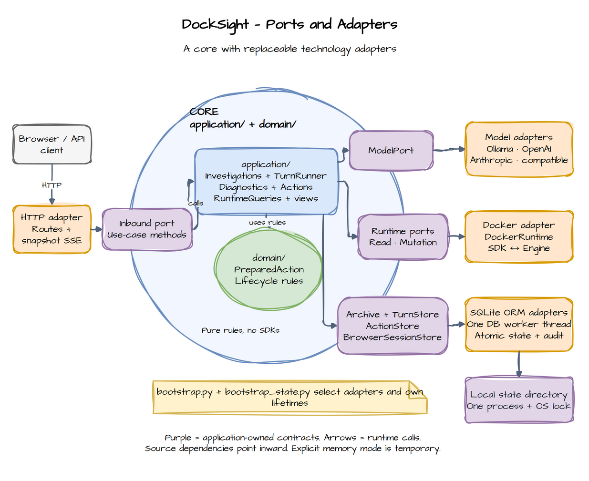
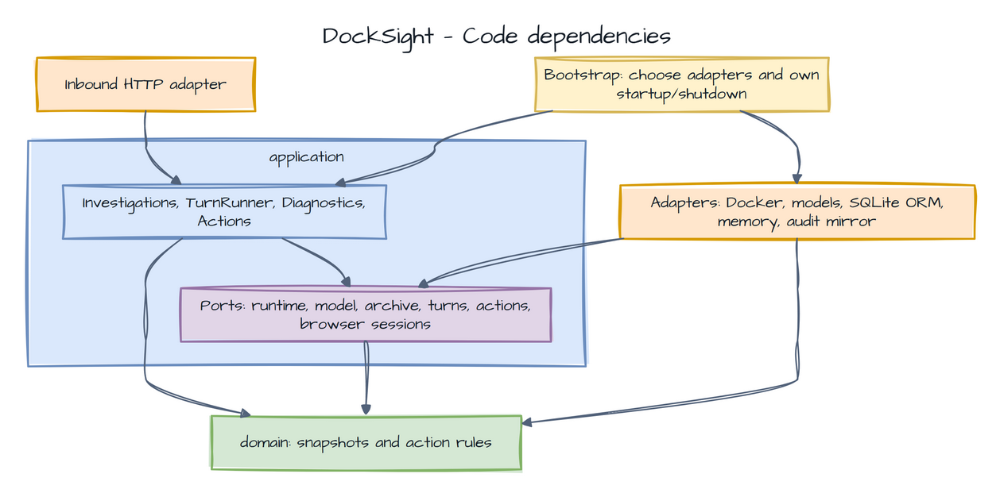
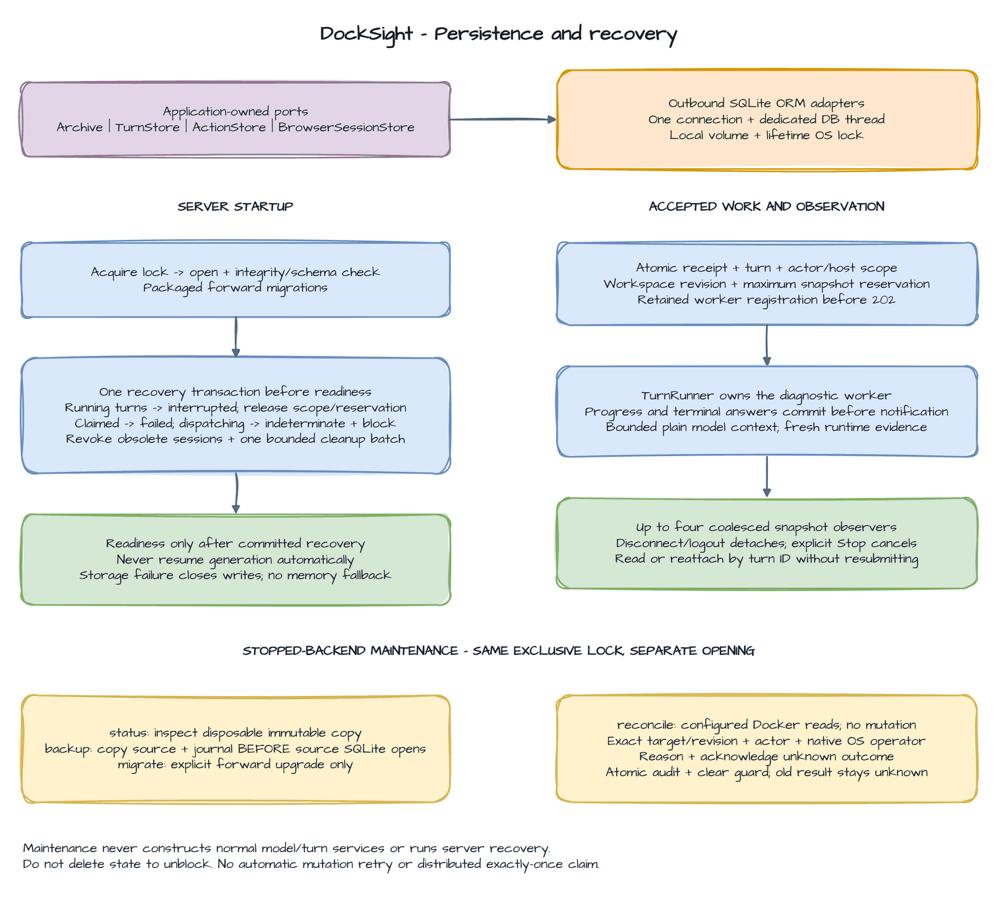
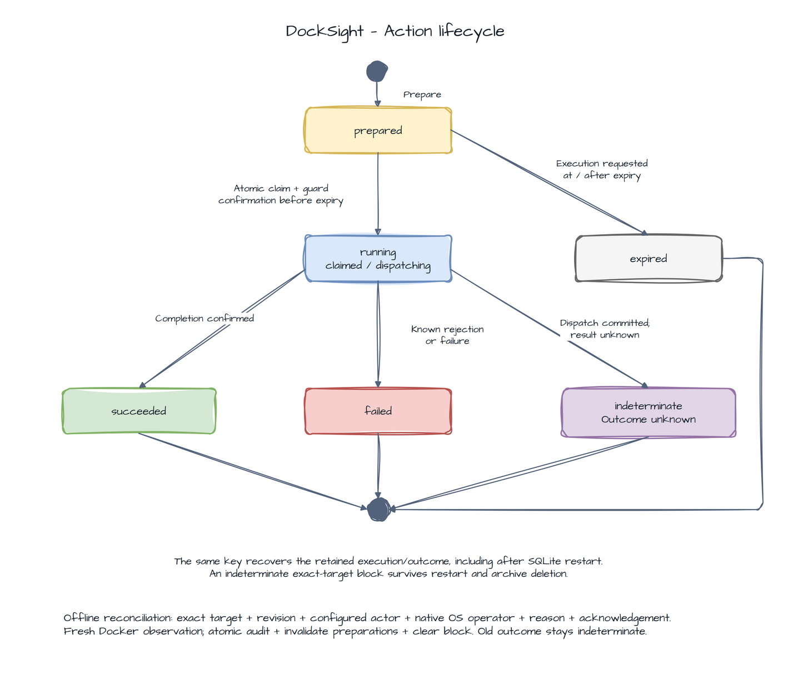

# Backend architecture

Diagram source: [backend.drawio](diagrams/backend.drawio).

See the [system overview](../README.md#how-it-works) for the diagnostic data flow.

## Decision

The backend is a monolith with one hexagonal boundary. Related behavior shares domain and application packages.
Adapters contain external technologies. The composition root constructs dependencies.
Split a feature into its own context when its language, rules, or ownership require it.



Arrows show runtime calls. Source-code dependencies point inward: the core does not import adapters. Memory adapters
run in the same process as the core.

## Dependencies

Arrows show allowed source-code dependencies. Outbound adapters implement application-owned ports. `bootstrap.py`
selects the concrete implementations and injects them into use cases.
Inbound and outbound adapters do not import each other, directly or indirectly. They interact through application-owned
contracts. The composition root may import both to construct the application.



| Component         | Responsibility                                                                |
|-------------------|-------------------------------------------------------------------------------|
| `RuntimeQueries`  | Docker reads                                                                  |
| `Diagnostics`     | Model calls, tools, and evidence collection                                   |
| `ViewAssembler`   | Typed responses built from model proposals and collected facts                |
| `Actions`         | Action preparation and confirmed execution                                    |
| `SystemStatus`    | Docker and provider metadata checks                                           |
| `ModelChoices`    | Provider/model selection against server-owned catalogs                        |
| `CatalogCache`    | Shared metadata fetches, freshness, failure cooldown, and cancellation        |
| `Investigations`  | Actor-owned archive reads, deletion, and revisioned workspace preferences     |
| `TurnRunner`      | Durable acceptance, retained diagnostic workers, Stop, and snapshot observers |
| `BrowserSessions` | Cookie authority, expiry, credential rotation, and bounded cleanup            |

- `domain` uses the standard library only. It owns values and business rules.
- `application` owns use cases, ports, tool orchestration, and output contracts. Pydantic may validate application DTOs
  and widget proposals. Domain entities do not inherit from Pydantic.
- `adapters` translate HTTP, Docker, provider SDKs, storage, and logging into application contracts. Application code
  never imports adapters or settings.
- `bootstrap.py` reads settings, selects adapters, injects dependencies, and manages resource lifetimes. `main.py`
  exposes the FastAPI application factory.
- Use-case functions/classes and their typed commands/results are the inbound ports. Do not add an interface that merely
  duplicates each use-case method.
- Outbound ports are application-owned `Protocol` types. Return owned values, not Docker SDK objects, HTTP responses, or
  provider message classes.
- `InvestigationArchive`, `TurnStore`, `ActionStore`, and `BrowserSessionStore` isolate storage. SQLite is the default
  adapter. PostgreSQL or Oracle adapters could implement these ports but are not included.

### Diagnostic turns

- Scope discovery supplies observed Compose/Swarm identities to the model tool loop.
- Broad incident questions collect a bounded local-host overview before model exploration. Counts, member state,
  collection limits, and fact cards belong to the server. A model cannot replace the overview with a group chooser.
- Narrowing to a group or exact container starts an explicitly scoped turn with fresh observations.
- Ambiguous names save an `awaiting_selection` turn with validated candidates. A clarification names that parent and
  its revision. The server accepts one exact candidate and retains the original question.
  It revalidates the selected target against fresh Docker data.
- Each turn owns a bounded evidence context and read-result memo. Repeated successful reads with the same arguments and
  scope return existing evidence references. Failures are not cached. A batch of only reused reads ends exploration.
- Final generation omits unvalidated prose drafts and includes a bounded recap of the latest lifecycle facts.
  Earlier questions and summaries are labeled as historical context.
- Schema and evidence-reference validation do not verify explanations. Causal regression tests detect selected known
  contradictions. They do not filter runtime responses.

### Status and model connections

`SystemStatus` uses `RuntimeReadPort.ping` and `ModelStatusPort`, with independent deadlines, public reason codes,
and UTC check times. It never calls `ModelPort.complete` or changes diagnostic or action state.
The metadata adapter owns provider-specific HTTP routes and credentials.

The catalog adapter owns pagination and HTTP handling. Bootstrap creates one reusable connection per configured
provider on demand. Selected adapters share those clients. `Diagnostics` instances share redaction, action
assembly, and the concurrency semaphore. Each turn keeps its own model and trace identity.

### Persistent state and retained work



One `PersistentDatabase` owns a local SQLite file, one connection on a dedicated database thread, and a lifetime OS
sidecar lock at the canonical path. Run one backend process with one worker. Shared network filesystems and multiple
writers are unsupported. SQLAlchemy ORM rows, sessions, SQL, Alembic, and transaction callbacks stay inside the outbound
persistence adapter. Ports return detached owned values. No transaction spans Docker, model, or catalog calls.

The adapter serializes short transactions, bounds admission to 32 operations with a two-second wait, and sets a
two-second SQLite busy timeout. It enables foreign keys, rollback `DELETE` journaling, and `synchronous=FULL`.
Accepted writes settle through caller cancellation. A failed commit closes write admission and returns
`storage_unavailable`. Successful reads may remain available. There is no silent memory fallback.
Sanitized draft and target input is validated before storage admission. Invalid redaction expansion returns a typed
input failure without closing unrelated writes. Container display labels are redacted. Sensitive group identities are
rejected instead of changing an exact lookup.

`Components.start` initializes storage before readiness. Initialization acquires the lock, checks integrity/schema,
applies packaged forward migrations, and atomically recovers abandoned turns/actions and obsolete browser sessions.
Running turns become `interrupted`, release reservations, and never resume generation automatically. Claims without a
dispatch marker become failed. Dispatch markers become indeterminate and retain their target blocks. Unsupported
schemas or failed migration/recovery refuse readiness. Maintenance opens separately without server initialization.

`TurnRunner` owns shielded acceptance and worker registration independently of HTTP requests. Acceptance saves the
submission receipt, running turn, actor/host scope, workspace revision, and storage reservation together. One diagnostic
per actor/host may run. Progress commits before observer notification. A terminal answer is published only after commit.
Up to four observers receive coalesced committed snapshots. Disconnect detaches observation. Explicit Stop settles the
retained worker and saves the winning terminal state. Shutdown drains workers before closing runtime and storage.

The complete display archive differs from model context. Only successful question/validated-summary pairs enter plain
model messages, bounded to ten whole pairs and 32,000 characters. Continued turns collect fresh runtime evidence.
Saved traces omit response previews, prompts, reasoning, and provider-native replay data.
Archive detail reads metadata and its initial turn page in one transaction. Public and internal turn reads share the
same snapshot ownership and lifecycle validator. Unsupported items retain their row IDs without exposing their content.
Action preparation carries server-owned request and diagnostic turn correlation into retained lifecycle audit.

SQLite has no age-based investigation eviction. The latest-ten list is pagination. Explicit deletion removes inactive
history/context/workspace but preserves action protection, audit, and content-free submission tombstones. Explicit
`memory` mode loses all state on restart. Only that mode applies `MAX_SESSIONS` and `STATE_TTL` to inactive history.

## Layout

```text
backend/src/docksight/
  main.py
  bootstrap.py
  domain/
    runtime.py           # Host/container identity and runtime snapshots
    diagnostics.py       # Evidence references and diagnostic conclusions
    actions.py           # PreparedAction and execution-state rules
    errors.py            # Domain failures
  application/
    ports/
      runtime.py         # Separate runtime read and mutation protocols
      models.py          # Provider-neutral model protocol and messages
      status.py          # Non-generative provider metadata checks
      state.py           # Action storage and reconciliation values
      browser_sessions.py # Browser authority storage
    investigations/      # Archive/turn ports, snapshots, acceptance, retained workers
    diagnostics/         # Turn orchestration, bounded trace, tools, context, prompts
    actions.py           # Prepare and execute workflows
    queries.py           # Host/container read workflows
    system_status.py     # Bounded dependency checks and safe public results
    model_catalog.py     # Public model metadata and bounded in-memory refreshes
    model_choices.py     # Validated provider/model selection
    events.py            # Transport-neutral turn events
    views/               # Widget proposals, registry, server assembly
  adapters/
    inbound/http/        # Routes, HTTP schemas, auth, error mapping, SSE
    outbound/
      docker/            # SDK connections, mapping, port implementations
      models/            # Ollama, OpenAI, Anthropic, Gemini/compatible API adapters
      memory/            # Explicit transient history, actions, and browser sessions
      persistence/       # SQLite ORM, migrations, lock, recovery, authoritative action audit
      audit.py           # Best-effort structured action audit mirror
```

## DDD elements

- Use a consistent vocabulary: Host, ContainerSnapshot, EvidenceRef, DiagnosticTurn, PreparedAction, and ActionOutcome.
- Use immutable values for identities, evidence references, action targets, and observations. Keep related values in the
  same cohesive file.
- Treat runtime inventory as an external read model. Container snapshots do not control the Docker daemon.
- `PreparedAction` owns its actor, target, operation, expiry, and legal state transitions. Its execution state is the
  consistency boundary. A store must atomically claim it before a runtime mutation can start.
- Keep expiry, confirmation, and transition checks in domain behavior. The application supplies the current time and
  actor, coordinates state access, calls the runtime, and records the outcome.
- Domain invariants do not make remote Docker calls transactional. Preserve an indeterminate outcome when execution
  cannot be confirmed.
- Add repositories only for stored state actually used by a workflow. Domain events, a generic unit of work, CQRS
  infrastructure, and an event bus are not required for this release.

### Prepared action lifecycle



`prepared` awaits confirmation. `running` records acceptance of an execution request. Expiry is calculated on reads
and enforced before execution. The same idempotency key reuses an existing
execution or retained outcome without another transition, including after SQLite restart. `running` has internal
`claimed` and `dispatching` phases. The dispatch marker commits before the SDK send. An `indeterminate` outcome blocks
further commands for the exact target until explicit offline reconciliation. Reconciliation retains the unknown old
outcome. See the [execution sequence](api.md#actions) and [operator procedure](configuration.md#action-reconciliation).

## Runtime boundaries

- `DockSightError` carries a safe public code, message, and transport-independent `ErrorKind`. The HTTP adapter maps
  the category to a response status. One public code may have different categories depending on context.
  Core rules and outbound adapters do not select HTTP statuses.
- Diagnostics receive a read-only runtime port. Actions receive the mutation port. Model tool registration includes no
  mutation method.
- Collect allowlisted, sanitized evidence before model access. The model proposes evidence references, explanation text,
  and allowed widget types. The application validates references and builds cards from real snapshots.
- Widget schemas and their registry belong to application output contracts. HTTP request/envelope schemas and SSE
  encoding belong to the inbound adapter. Neither belongs in `domain`. Schema conversion for a model provider belongs in
  that provider's outbound adapter.
- Diagnostics call action preparation directly to attach permitted actions to cards.
- Claim, guard, idempotency key, and authoritative audit commit atomically. Dispatch and terminal state use revision
  checks. Serialize mutations for the same host/full container ID in the state adapter. Keep action rules in the core.
- Disconnect detaches a diagnostic observer. Explicit Stop cancels diagnostic work. Track a started mutation to a known
  or indeterminate outcome even if its caller disconnects. A timed-out thread call does not prove Docker cancellation.
- Persist the dispatch marker before sending. A crash after that marker conservatively blocks the target even when
  Docker may never have received the command. A late SDK result cannot rewrite an indeterminate outcome. Never retry
  a mutation automatically. Docker and SQLite do not provide a distributed exactly-once execution guarantee.
- Restart, archive deletion, token rotation, and preparation expiry do not clear durable indeterminate guards.
  Offline reconciliation rereads Docker and records the native OS operator plus configured actor without a mutation.
- Inject a clock callable for time-based rules. Core tests use small fake ports without Docker or model SDKs.

## Verification

- Enforce import direction in CI with `import-linter`. Verify that application imports no adapters, FastAPI, Docker SDK,
  HTTPX, provider SDKs, or settings. Verify that domain imports no application, adapter, or third-party package.
  An independence contract rejects direct and indirect imports between inbound and outbound adapters.
- Test domain rules and use cases through fake ports. Test adapter mappings separately, then verify HTTP contracts and
  the real Docker example.

## References

- [Hexagonal architecture](https://alistair.cockburn.us/hexagonal-architecture)
- [DDD aggregates](https://martinfowler.com/bliki/DDD_Aggregate.html)
- [Import Linter forbidden contracts](https://import-linter.readthedocs.io/en/stable/contract_types/forbidden/)
