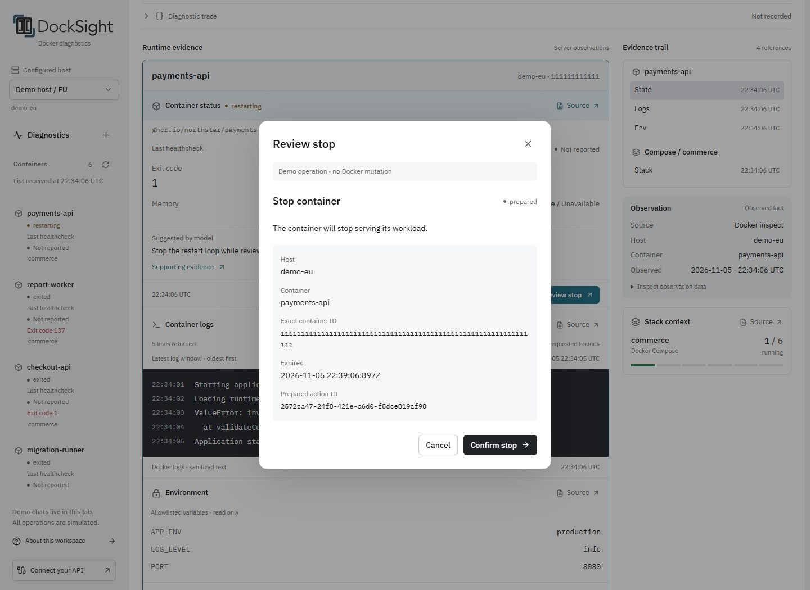

# Usage examples

Start the application using the [quick start](../README.md#quick-start).

## Browser investigation

Choose **Explore Demo** from the entry screen, or **Return to demo** from an API workspace.
Demo uses fictional hosts and local fixtures. It needs no backend, Docker connection, or model.
An initial session-read failure offers **Retry connection** and explicit **Explore Demo** entry.

1. Choose **Crash loop** in the scenario selector.
2. Read the diagnostic conclusion and compare it with container state and startup logs.
3. Choose **Container evidence** or **Log evidence** to inspect the referenced observation.
4. Choose **Review stop** to inspect the exact target and operation before confirmation.



*Simulated action. Confirmation in Demo does not change Docker resources.*

Other scenarios cover OOM, failed dependencies, truncated logs, an unconfirmed exit, and a running container with
zero CPU.
Expand **Test error states** to explore connection, streaming, inventory, and action-result failures.

For your own Docker environment, choose **Connect API**, enter the backend token, and select a configured host.
Select a container to read its state, metrics, and logs without using the model. Choose **Diagnose** or ask a question
to start model-assisted investigation. Follow-ups stay scoped to the same host. Same-origin login uses an HttpOnly
cookie to restore saved chats and acknowledged drafts after refresh. A separate-origin connection requires reconnecting.
Open earlier results in **Saved chats** and use **Older chats** to page beyond the latest ten.

Ask "What happened?" without selecting a resource to get a bounded host overview across projects and containers without
an observed group. Review collection limits and missing logs, then choose **Investigate container** or an observed group
for a focused question with fresh reads. Earlier answers and the composer draft remain available.
A question naming an ambiguous resource still asks which target you mean.

Restart and stop require separate confirmation of a server-prepared action. After execution, refresh the container
overview for current observations. Earlier diagnostic cards retain their original evidence.
Reopening an action review first reads the existing action. It never prepares a replacement automatically.
**Stop diagnosis** cancels the active diagnostic turn. Reloading or changing chats only detaches observation.

## Docker example

The example worker exits on its first start and runs after a confirmed restart. A dedicated demo volume holds its retry
marker. Start the backend with access to the same Docker environment and configure a model. From the repository root:

```sh
docker compose -f examples/compose.yaml up -d
uv run --project backend python examples/demo.py diagnose
```

The default project name is `docksight-demo`. Reusing its volume skips the first-start failure.
If that project already exists, use a new name in both commands:

```sh
docker compose -p docksight-example -f examples/compose.yaml up -d
uv run --project backend python examples/demo.py diagnose "Why did the worker in Compose project docksight-example exit?"
```

Use the same `-p docksight-example` option for subsequent Compose inspection and cleanup commands.
For a backend on another port, put `--url http://127.0.0.1:18080` before `diagnose`, `execute`, or `state`.

Review the diagnosis, evidence, and `actions` in the returned card. Copy a prepared restart action ID and confirm it:

```sh
uv run --project backend python examples/demo.py execute ACTION_ID --confirm --key review-restart-1
uv run --project backend python examples/demo.py state ACTION_ID
docker compose -f examples/compose.yaml ps -a
```

Keep the same idempotency key for that execution. If a response is lost, read the action state before considering a
repeat request. Never automatically retry a Docker mutation. An `indeterminate` result retains an exact-target block
until [offline reconciliation](configuration.md#action-reconciliation). Check Docker directly before reconciling.
The [API reference](api.md#actions) describes expiry, execution outcomes, and revalidation.

Remove the demo stack, its volume, and the retry marker:

```sh
docker compose -f examples/compose.yaml down -v
```

Use the same project name as above. Remove only the example you created.

## HTTP integration

Open [interactive API documentation](http://127.0.0.1:8000/docs) and enter the bearer token through **Authorize**.
Use the [HTTP API reference](api.md) for container reads, POST-based diagnostic SSE streams, and action requests.
