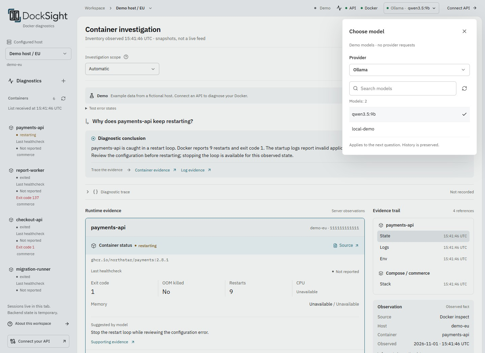

# Frontend

[Quick start](../README.md#quick-start) · [Usage examples](examples.md) ·
[Deployment](configuration.md#frontend-deployment)

## Boundaries

- Stack: React, strict TypeScript, and Vite in `frontend/`.
- Transport: validated backend contracts, authenticated reads, POST SSE, cancellation, and confirmed action execution.
- Credentials: browser memory only.
- Investigations: one configured host, within the current tab.
- Demo: separate, labeled transport with fictional hosts and fixtures matching backend contracts. No Docker or model
  calls. Scenario and error controls are disabled during collection.

Demo logs are fixed. Browser tests use mocked API responses for longer log scrolling.
See [contributor checks](../CONTRIBUTING.md#checks).

## Interface and evidence

The workspace keeps model explanations separate from Docker observations. Explanation links select a widget and its
source observation. Evidence references apply to the whole response. The client must not invent per-sentence citations.
The evidence inspector shows the original source kind, host, container, UTC time, and sanitized data.

Broad incident questions show a server-owned **Host overview** before individual cards. It includes local inventory
counts, process and health state, observed groups, log coverage, and explicit clipping or discovery warnings. Counts
exclude remote Swarm replicas, and **Needs review** does not prove a failure. The overview's **Source** opens its `host`
observation. Log links open exact-container observations.

**Investigate container** and group choices start a separate session with an explicit target and fresh reads. They
preserve earlier answers and the next-question draft. Ambiguous named resources retain the clarification flow in the
existing session. See [host overview contracts](api.md#host-overview).

IBM Plex Sans is used for interface text and IBM Plex Mono for code and identifiers. The logo and favicon live in
`frontend/public/brand/`. Status colors describe runtime state, uncertainty, and action outcomes.
Logs, environment values, observation JSON, and model text render as text, never executable HTML.

| Control | Behavior |
|---------|----------|
| Tab / Enter / Escape | Follow reading order / activate / close dialogs or cancel a menu choice |
| Ctrl/Cmd+Enter | Submit a query |
| Selection menus | Arrow keys, Home/End, and typeahead |
| Scope help | Available on hover, focus, or tap |
| Outside dialog click | Close the dialog. Content clicks, padding clicks, and text drags keep it open |
| Close action review | Preserve the prepared action without confirming it |
| **Ask DockSight** / source link | Focus the composer / selected observation |
| Workspace breadcrumb | Open host selection, including on mobile |

Closing host selection or choosing the current host preserves the draft, investigation, and prepared actions.
Changing hosts or connections cancels outstanding work and discards the previous workspace.

## Inventory and container reads

Container process state and healthcheck results are separate in inventory, facts, cards, and Compose rows.

| Observation                                       | Display                                        |
|---------------------------------------------------|------------------------------------------------|
| Missing or null health, including older responses | Not reported                                   |
| Running count                                     | Running processes, independent of healthchecks |
| Diagnostic card header                            | Process state                                  |
| Healthcheck                                       | Separate fact row and compact-list label       |
| Stopped process healthcheck                       | **Last healthcheck**                           |
| Exited process / nonzero exit code                | Neutral status / highlighted exit code         |

API inventory refreshes 10 seconds after each read settles. Polling pauses while hidden or offline.
Returning online, becoming visible, or focusing the page triggers a read. Failures back off to 20, 40, and at most
60 seconds. Success restores 10 seconds. Reads do not overlap. Demo refresh is manual.

Refresh retains the last successful inventory, selection by exact container ID, keyboard focus, and investigation state.
Failures label retained rows as stale and offer retry. The receipt timestamp changes only on success and records browser
receipt, not a Docker observation. Manual refresh announces loading and shows success for two seconds.
Refresh icons rotate during reads unless reduced motion is enabled. Historical diagnostic cards and actions never change.

Selecting a container opens its read-only overview without using the model or preparing actions. Inspect, `/stats`,
and `/logs?lines=200` load independently. Inspect includes allowlisted environment values. These reads are not atomic.
The overview has no direct restart or stop controls.

Visible inspect refreshes with inventory polling. Logs and metrics refresh manually. **Refresh data** rereads all sources.
Leaving the overview cancels its requests and polling. Reopening rereads its sources.
A failed source retains its last successful values. Other sources remain usable.

State and environment use the server's `observed_at`. Metrics and log batches show browser receipt time as **Received**.
Individual logs retain Docker timestamps.

Only inspect returning `container_not_found` with HTTP 404 confirms removal and stops automatic reads for that container.
Absence from the inventory, which is bounded to 200 containers, does not prove deletion.
A new container with the same name never replaces the selected ID. Inspect failures disable diagnosis until an explicit
successful read. **Diagnose** starts a new session for the exact selected container. Prior answers stay in this tab.
Returning to the investigation preserves its draft, evidence, prepared action IDs, and execution keys.

## Actions

Server-prepared `actions` define the permitted operations. Optional `recommendation` metadata links an explicit model
suggestion to an existing action ID. Its review button includes the model reason and links to supporting observations.
The client never infers a recommendation from narrative text, container state, or action order. Older responses without
that metadata list every operation under **Actions**.

An `actions_code` labels unavailable action preparation while keeping the observed container facts visible. Such cards
expose no executable action or recommendation. Refresh or diagnose again to collect current observations.

The action disclosure closes on selection, Escape, or an outside click. Cancelling confirmation restores focus to the
stable trigger. Reviewing an action never executes it. Execution requires separate confirmation of the exact host,
container, operation, and expiry, and keeps one idempotency key.

A lost execution response triggers an action read, never an automatic Docker mutation retry. A confirmed request may
be repeated with its original key only after reading that the action is still prepared. An `indeterminate` outcome
requires operator inspection of Docker. Historical cards retain original observations and recommendations.
See [confirmation example](examples.md#browser-investigation) and [server action contracts](api.md#actions).

## Diagnostic trace

Each turn has a collapsed **Diagnostic trace** disclosure with public provider/model identity, request/turn IDs,
recorded steps, measured duration, and optional token usage. Selecting a step reveals safe failure details or sanitized
model output before server card assembly. Desktop shows steps beside details. Smaller screens use one pane at a time.
**Back to steps** restores focus to the selected step.

Model steps expose normalized assistant `content` and requested `tool_calls`, including IDs, names, and redacted arguments.
Tool calls are untrusted proposals and grant no execution permission. Previews normalize the provider response.
Invalid or oversized final proposals are withheld. Clipped previews are labeled. Missing usage differs from zero.

Updates replace steps by ID and remain attached to their turn. Failed or disconnected turns retain received steps.
Unfinished steps become interrupted without invented completion or duration. Older servers and previous turns without
trace events display **Not recorded**. Demo traces are simulated and make no API or model request.

**Copy trace** excludes the operator query, credentials, and action execution keys. Trace data stays in browser memory.
Locale changes preserve it. Inventory polling never replaces historical trace data.
See [SSE and trace contracts](api.md#diagnostic-stream).

## System status

The top bar shows API/Docker status and a separate model selector. The status panel includes provider/model details.

- Check after connection and host discovery, on host changes, and through **Check again**.
- In API mode, repeat 60 seconds after settlement while visible and online. Demo checks are manual.
- On panel opening or foreground return, recheck results at least 30 seconds old. Recent results keep the next check.
- Do not overlap reads. Manual retry during a read queues one follow-up.

Transport failures or unavailable dependencies back off to 120, 240, and at most 300 seconds. Healthy or unchecked
dependencies restore 60 seconds. HTTP 401/403 stops automatic checks until a manual retry verifies authorization
or the connection changes. A successful authorized response resumes polling even if a dependency remains unavailable.

Rechecks retain prior results and timestamps. Failed API checks mark retained dependency results as stale.
Success replaces results for that host only. Dependency times come from the server. API times record browser receipt
or failure. The panel shows polling, backoff, or stopped checks and exposes no credentials or provider URLs.

Metadata availability does not verify generation, tools, or structured output. Unsupported checks stay `not_checked`
and allow explicit diagnosis. Confirmed unavailability disables new diagnoses, including keyboard submission and retry,
while preserving drafts, history, and action state. Provider/model failures leave direct Docker reads available.
See [dependency status](api.md#dependency-status).

## Model selection

The header names the active provider/model. **Choose model** opens configured providers, a searchable model list,
and **Refresh models**. Unconfigured providers are disabled. Demo uses visibly simulated catalogs and makes no requests.
Catalogs load only on opening the picker or selecting a provider. The client reuses results for five minutes.
Stale rows remain visible during refresh. Errors retain previous/configured choices and the active model.

Selecting a row applies to the next question and updates its status checks. It preserves the current draft, session,
evidence, historical trace, prepared actions, and execution keys. Switching is disabled during a diagnostic turn.
The choice stays in this tab across host changes. Reconnecting or reloading resets it.
Provider keys stay in server environment settings. Neither keys nor model preferences enter browser storage.
Catalog availability does not verify tool support.

## Browser state and lifetime

Only the display-language preference (`docksight.locale`) is stored in localStorage. The default follows browser language
preferences. Invalid or unavailable storage falls back to System. Changing this preference preserves connections,
sessions, drafts, evidence, traces, actions, and execution keys.
Logs, environment values, identifiers, and API/model text remain verbatim. Display-language changes never translate API
explanations, even when they match Demo text.

The client has no durable conversation history, metric history, environment editing, or stack deployment.
Streams cannot replay or reconnect automatically. Refresh the container overview for current facts or run a new diagnosis
for fresh evidence. See [process state and recovery](configuration.md#process-state-and-recovery).
