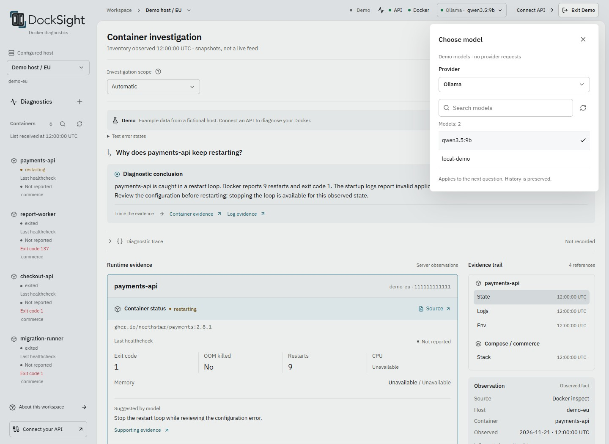

# Frontend

[Quick start](../README.md#quick-start) · [Usage examples](examples.md) ·
[Deployment and state](configuration.md#frontend-deployment) · [API contracts](api.md)

## Boundaries

The client uses React, strict TypeScript, and Vite. `frontend/src/main.tsx` starts the application.

| Directory                                                | Ownership                                                                                      |
|----------------------------------------------------------|------------------------------------------------------------------------------------------------|
| `src/app/`                                               | Construct transports and compose public feature APIs into the workspace                        |
| `src/modules/`                                           | Own session, investigations, runtime, actions, model selection, and system status capabilities |
| `src/infrastructure/api/` and `src/infrastructure/demo/` | Implement API and Demo transports                                                              |
| `src/shared/`                                            | Reuse contracts, UI, localization, helpers, and style foundations                              |

Product modules use shared contracts, not concrete transports. Cross-module imports use public entries.
Investigations can use the public actions and runtime presentation APIs. Other cross-module dependencies are forbidden.
Shared cannot depend on app, modules, or infrastructure. Infrastructure cannot depend on app or modules. Modules cannot
depend on app or infrastructure. The app consumes module public entries. Dependencies must not form cycles.
The layout and dependency checks enforce these boundaries, with narrow exemptions for colocated tests.

Workspace state, controllers, and connections have stable owners. Keep feature behavior in its module and compose it in
the app. Prefer pure cohesive helpers and local component state where state need not cross a boundary. CSS Modules own
component styles. `src/shared/styles/` supplies global fonts, foundation, responsive rules, and reduced-motion rules.

## Connection and recovery

At startup the client probes the first-party cookie session. A valid session opens API mode. An unauthorized response
offers sign-in or explicit **Explore Demo**. A network failure offers retry. If the retry returns an unauthorized
response, the sign-in screen explains that the session is no longer valid. Demo is labeled and uses fictional data,
separate transport, and no Docker or model calls. Its history lives in the tab.

Same-origin sign-in exchanges a bearer token for an opaque HttpOnly cookie. JavaScript keeps the session identity and
CSRF value in memory. Sign-out revokes the session without deleting history or stopping accepted diagnoses. Other tabs
lose authority on their next request or observer check.

Separate-origin bearer access omits cookies and requires reconnecting after refresh. See
[public-origin setup](configuration.md#public-origin-and-proxy-setup).

## Browser state and lifetime

The endpoint, bearer token, and CSRF value stay in memory and never enter browser storage or the page URL.
Provider credentials stay on the backend.
The locale is the only JavaScript browser-storage preference. It follows browser language unless explicitly selected.
The language selector is beside the DockSight logo on the sign-in screen.

## Saved chats and drafts

API chats belong to the authenticated actor and each is scoped to one configured host. The latest ten form one page,
not a retention limit. Older chats remain available through pagination. Last-active chat is restored only at bootstrap.
An active diagnosis replaces its chat's delete control with a progress indicator. The list checks active chats for
completion while the page is visible, including when another chat is open.
Known activity in another chat blocks a new diagnosis on the same host. If activity changes before the server admits a
question, the client explains the conflict and refreshes the saved chat list.
Focus refreshes the open chat and list without following another tab's navigation. Deletion requires confirmation and
cannot remove a running diagnosis. Server action protection survives history deletion.

**New investigation** opens a local editor. Repeated clicks in an empty editor focus the same input. The first
nonblank draft or an explicit diagnosis creates a saved chat. Drafts with text remain in history.

Draft writes are serialized, revisioned, and scheduled after 300 ms of inactivity. Text typed during initial chat
creation remains in the tab until the matching server acknowledgement, then enters normal revisioned saving. Reload
restores acknowledged data only. Navigation waits for pending saves. A failure or conflict preserves the local draft and
workspace. The operator explicitly retries, reloads the saved draft, or chooses to use the local draft. Focus reads do
not silently rebase a dirty workspace revision.

Saved host, model, scope, container selection, and view come from the server workspace. Selecting a saved chat from the
sidebar opens its diagnostics directly, even if its last view was a container. A removed host or model leaves
the archive readable but requires an explicit valid choice before continuation. Changing host starts another chat.
An unavailable container retains its full historical ID. A replacement with the same name is never substituted.
See [saved investigations and workspaces](api.md#saved-investigations-and-workspaces) and
[process state and recovery](configuration.md#process-state-and-recovery).

## Questions and observation

Submitting a question waits for pending workspace saves. Clarification continues the saved original question using its
exact observed target and parent revision. Earlier turns remain available independently of model context.

An accepted turn belongs to the backend. Refresh, focus, and reconnect read and observe that same turn without
resubmitting it. Navigation or disconnect detaches observation without cancelling accepted work. Only explicit
**Stop diagnosis** cancels the exact active turn. A late Stop response cannot detach a newer turn. A lost submission
response is recovered through history reads. If recovery is unavailable, check history before submitting manually.
After backend restart, abandoned turns are marked interrupted rather than resumed.

## Interface and evidence

Saved cards, evidence, request IDs, and safe trace metadata are historical snapshots. Continuing collects fresh Docker
observations. Observation resumes from committed snapshots and may omit intermediate progress. Explanation links select
widgets and source observations. Evidence references apply to the whole response, not individual sentences. Logs,
environment values, observation JSON, and model text render as text, never executable HTML.
See [host overview](api.md#host-overview).

## Diagnostic trace

The diagnostic trace shows public provider/model identity, request and turn IDs, steps, duration, and available token
usage. It grants no execution permission. Copy excludes the question, credentials, and execution keys. Demo traces are
simulated. See [snapshot observation](api.md#snapshot-observation) and [diagnostic stream](api.md#diagnostic-stream).

## Inventory and container reads

Process state and healthcheck results are distinct. Inventory polling runs after each successful or failed read settles,
pauses while hidden or offline, and backs off on failure. Refresh retains the last successful rows, exact container
selection, focus, and investigation state. A failed read marks retained rows stale. Demo refresh is manual.

Selecting a container opens a read-only overview. Inspect, metrics, and logs load independently and are not atomic.
Inspect includes allowlisted environment values. Failed sources retain their last successful values. Only an inspect
`container_not_found` response confirms removal. Absence from bounded inventory does not establish deletion.

Container diagnosis uses the exact selected ID. **Diagnose in a new chat** starts a separate investigation and
preserves the previous chat and its draft. **Continue in current chat** adds the container to the open investigation.
Both destinations are shown when the open chat has a request or a draft. An empty chat offers **Diagnose** in place.
Hover over a blocked action or open its help button to see why it is unavailable. Selecting a container does not
start or stop a turn. Finished answers and historical observations stay in their original chats.
Demo retains previous chats in memory for the current host.

## System status

API dependency checks poll while visible and online, back off on
failure, and stop automatic checks on authorization failure. Confirmed dependency unavailability disables new
diagnoses while preserving drafts, history, and actions. Demo status is simulated. See
[dependency status](api.md#dependency-status).

## Model selection

Model selection affects the next question and is disabled during a turn. Catalog availability does not establish
generation or tool support. Demo catalogs are simulated.

| Client activity   | Timing                                                                                                                                                  |
|-------------------|---------------------------------------------------------------------------------------------------------------------------------------------------------|
| Inventory         | 10 seconds after settlement, backing off to 20, 40, then 60 seconds on failure                                                                          |
| Dependency status | 60 seconds after settlement, backing off to 120, 240, then 300 seconds on failure. Foreground or panel opening rechecks results at least 30 seconds old |
| Turn observation  | Dropped reads retry after 1, 2, 4, 8, then 10 seconds while visible and online                                                                          |
| Model catalog     | Reuse results for five minutes                                                                                                                          |

## Actions

The server prepares permitted actions. Recommendation metadata can link a model suggestion and reason to an existing
action. The client does not infer recommendations from narrative, state, or action order. Unavailable preparation leaves
the observed facts visible without an executable action.

An archive opens with action review closed. Opening review reads the existing action and checks its ID, host, full
container ID, and operation before enabling confirmation. Missing, foreign, expired, or indeterminate actions remain
unavailable. Review never prepares a replacement. Confirmation is separate and identifies the current server-prepared
target, operation, and expiry.
Every later read and execution result must match that original identity. Failed or mismatched reads block confirmation
until a matching read succeeds. Results from a previous connection cannot update the current review.

Each execution uses one idempotency key. A lost response triggers an action read, never an automatic Docker mutation
retry. A confirmed request can be repeated with its original key only after a read shows the action is still prepared.
An indeterminate outcome requires operator inspection and
[offline reconciliation](configuration.md#action-reconciliation).
Reload restores neither queued mutations nor open confirmations. Historical cards retain their original observations.
See [action contracts](api.md#actions) and the [confirmation example](examples.md#browser-investigation).

## Development and checks

Use the [contributor workflow](../CONTRIBUTING.md#checks) for static checks, coverage, production-preview browser tests,
and the deterministic SQLite persistence suite. Browser tests use mocked API responses unless the persistence or live
suites are selected. Demo observations and traces must remain visibly labeled.
